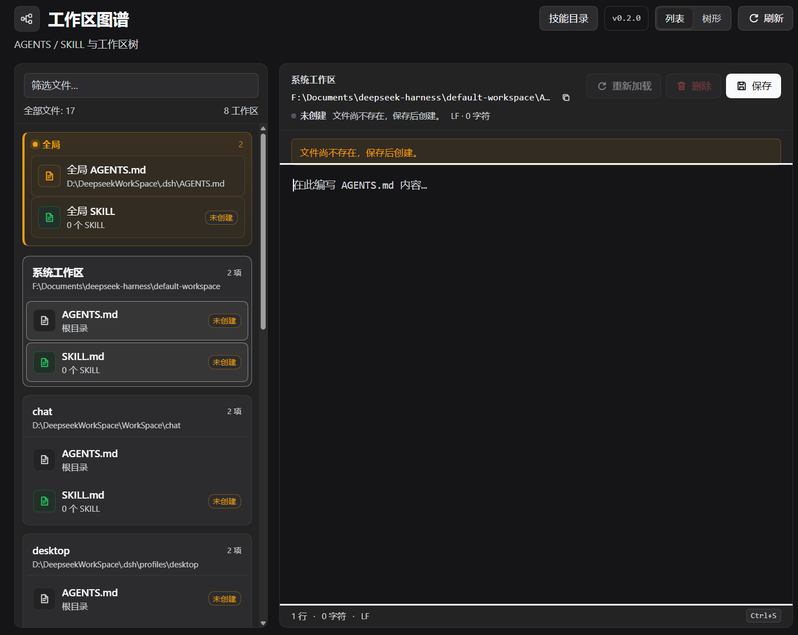
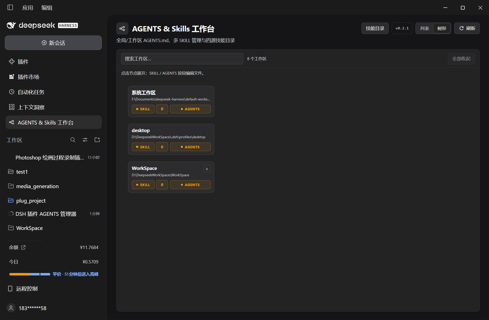
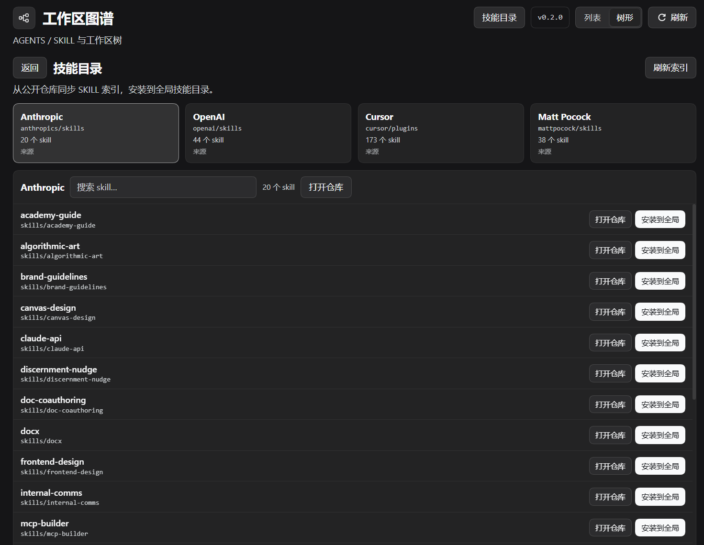

# AGENTS & Skills Studio

<p align="center">
  
</p>

<p align="center">
  AGENTS & Skills 工作台 · edit AGENTS.md, manage multiple skills, and install from four public skill catalogs.
</p>

AGENTS & Skills Studio is a full-page panel for DeepSeek Harness / DSH NEXT. It manages both kinds of workspace instruction files:

- global and workspace-root `AGENTS.md`
- multiple project skills at `<workspace>/.dsh/skills/<name>/SKILL.md`
- the global skill directory at `$DSH_HOME/skills`
- local skill library, URL import, and whole-directory installs from four public catalogs

Four skill sources:

| Source | Repository |
|---|---|
| Anthropic | `anthropics/skills` |
| OpenAI | `openai/skills` |
| Cursor | `cursor/plugins` |
| Matt Pocock | `mattpocock/skills` |

It also provides list and left-to-right tree views, tree search, SKILL counts, backups, conflict detection, and path-escape protection.

> This is a community plugin. It is not an official DeepSeek product.

> 中文简介：AGENTS & Skills 工作台是一个 DSH 全页面插件，用来管理全局与工作区根 `AGENTS.md`、多个 `.dsh/skills/<name>/SKILL.md` 和全局技能目录。支持列表/横向树视图、搜索定位、SKILL 数量统计、新建/编辑/删除、URL 导入、本地技能仓库，以及从 Anthropic（`anthropics/skills`）、OpenAI（`openai/skills`）、Cursor（`cursor/plugins`）、Matt Pocock（`mattpocock/skills`）四源技能目录整目录安装。包含备份、外部修改冲突检测和路径逃逸防护。

## Features

- Two views, switchable at any time:
  - **List** — flat, alphabetically sorted workspaces; each workspace shows its root `AGENTS.md` and a SKILL summary with count.
  - **Tree** — a left-to-right forest derived from workspace paths.
- Tree nodes start collapsed. Click a node to expand its children. Expand and collapse use a smooth 220 ms animation.
- Tree search initially lists matching nodes only. Selecting a result expands its ancestors and its complete subtree, then scrolls it into view.
- Every tree node has `SKILL` and `AGENTS` buttons:
  - green when content exists
  - orange when it does not
  - `SKILL` also shows a count box
- `SKILL` opens a manager for multiple project skills:
  - native skills at `<workspace>/.dsh/skills/<name>/SKILL.md`
  - legacy root `SKILL.md` kept as a separate row
  - create, edit, delete, import from a raw URL, save to the local library, install from the library
- Local skill library at `$DSH_HOME/workspace-atlas/skills`.
- `AGENTS` opens the workspace root `AGENTS.md` editor.
- Global `AGENTS.md` editor: `$DSH_HOME/AGENTS.md`.
- Markdown text editing with LF/CRLF and UTF-8 BOM preservation.
- `Ctrl+S` / `Cmd+S` save, `Tab` inserts two spaces.
- Unsaved-change tracking, external-change conflict detection, reload, and delete.
- Header version button with GitHub Release checking and one-click update through DSH Plugin Manager.
- Atomic writes and automatic backups under `$DSH_HOME/agents-manager-backups/`.
- Global skill management at `$DSH_HOME/skills`.
- Chinese and English locale, DSH theme tokens, no private Harness UI imports.

## Screenshots







## Skill catalog

The header's **Skill catalog / 技能目录** button opens a separate catalog view:

- four source cards: Anthropic, OpenAI, Cursor, Matt Pocock
- the catalog syncs on open and can be refreshed manually
- selecting a card shows that repository's skills
- each row can install into the global skill directory or open the source directory on GitHub
- indexes are cached under `$DSH_HOME/workspace-atlas/catalog.json`

Sources:

| Card | Repository |
|---|---|
| Anthropic | `anthropics/skills` |
| OpenAI | `openai/skills` |
| Cursor | `cursor/plugins` |
| Matt Pocock | `mattpocock/skills` |

Catalog installation downloads every file in the selected skill directory, not only `SKILL.md`. It installs into `$DSH_HOME/skills/<name>` and refuses to overwrite an existing skill.

## Create and edit skills

New skills use the [Agent Skills specification](https://agentskills.io/specification):

| Field | Required | Notes |
|---|---|---|
| `name` | yes | Lowercase letters, numbers, and single hyphens; 1-64 characters |
| `description` | yes | 1-1024 characters; what the skill does and when to use it |
| `license` | no | License name or a bundled license file |
| `compatibility` | no | Environment requirements; up to 500 characters |
| `metadata` | no | String key-value mapping |
| `allowed-tools` | no | Space-separated pre-approved tools |

The create form collects all six fields plus the Markdown body, then writes a canonical `SKILL.md` with YAML frontmatter. Existing native skills open in the same structured editor.

The edit page has a file tab for everything outside the root `SKILL.md`:

- create nested files and folders under the skill directory
- edit and save text files such as `references/guide.md` or `scripts/run.py`
- delete files or folders
- path validation keeps every operation inside that skill directory

Legacy root `SKILL.md` remains a raw Markdown editor.

## Install

Requirements:

- DeepSeek Harness / DSH NEXT with the Web UI and Plugin Manager
- Node.js `>=22.19.0`

Clone this repository and install the directory as a bundle in the profile used by the desktop app:

```powershell
git clone https://github.com/Asteroid-Code-Channel/dsh-workspace-atlas.git
```

In DSH, open Plugin Manager and install the cloned directory, or ask the agent:

```text
请把 <absolute-path-to>\dsh-workspace-atlas 作为 bundle 安装到当前 profile。
```

Equivalent `plugin_manager` call:

```text
plugin_manager
action: install_bundle
target: <absolute-path-to>\dsh-workspace-atlas
```

Refresh the Web UI after installation. Restart the desktop app after updating Host-side JavaScript.

For a different desktop UI, repeat the installation in that profile.

## Usage

1. Open the sidebar entry named **AGENTS & Skills Studio / AGENTS & Skills 工作台**.
2. Choose **List / 列表** for a flat alphabetical overview.
3. Choose **Tree / 树形** for the workspace forest.
4. Click a node card to expand it.
5. Use `SKILL` to manage that workspace's native skills and legacy root `SKILL.md`.
6. Use `AGENTS` to edit the workspace root `AGENTS.md`.
7. Use the global card in List view to edit `$DSH_HOME/AGENTS.md` or manage `$DSH_HOME/skills`.
8. Use the header's Skill catalog to sync and install public skills globally.

## File rules

- Tree parent/child relationships are derived from registered workspace paths. The DSH workspace registry is never modified.
- A workspace with no registered ancestor becomes a root tree.
- Native project skills: `<workspace>/.dsh/skills/<name>/SKILL.md`.
- `SKILL` also shows a legacy root `<workspace>/SKILL.md` when present.
- `AGENTS` edits workspace-root `AGENTS.md`.
- Skill deletion moves the skill directory to `$DSH_HOME/workspace-atlas/trash/`.
- The local skill library is `$DSH_HOME/workspace-atlas/skills/<name>/SKILL.md`.
- URL import downloads one `SKILL.md`; it does not fetch a skill's auxiliary files.
- The list shows root `AGENTS.md` and the SKILL summary only; nested `AGENTS.md` files are not listed.

## Version updates

The header shows the installed version. Click it to check the latest GitHub Release.

The update source is resolved from, in order:

1. `updateRepository` in the bundle's `cordis.patch.yml` row config
2. `repository` in `package.json`

Use an `owner/repo` value. After creating the GitHub repository, add:

```json
"repository": {
  "type": "git",
  "url": "https://github.com/Asteroid-Code-Channel/dsh-workspace-atlas.git"
}
```

When a newer Release exists, the dialog can call DSH Plugin Manager's `installBundle` with `github:<owner>/<repo>#<tag>`. A restart is required after a Host update. If Plugin Manager does not expose `installBundle`, the dialog still links to the Release page for a manual update.

## Host API

The Host half registers these same-origin endpoints:

| Method | Path | Purpose |
|---|---|---|
| `GET` | `/api/dsh-agents-manager/state` | Global file, workspaces, AGENTS/SKILL metadata, version |
| `POST` | `/api/dsh-agents-manager/read` | Read a target |
| `POST` | `/api/dsh-agents-manager/save` | Atomic save + backup |
| `POST` | `/api/dsh-agents-manager/delete` | Delete + backup |
| `POST` | `/api/dsh-agents-manager/skills/list` | List native + legacy skills |
| `POST` | `/api/dsh-agents-manager/skills/create` | Create a native skill |
| `POST` | `/api/dsh-agents-manager/skills/read` | Read parsed skill fields and body |
| `POST` | `/api/dsh-agents-manager/skills/save` | Save structured fields and body |
| `POST` | `/api/dsh-agents-manager/skills/files` | List a skill directory |
| `POST` | `/api/dsh-agents-manager/skills/file/read` | Read a skill file |
| `POST` | `/api/dsh-agents-manager/skills/file/save` | Save a skill file |
| `POST` | `/api/dsh-agents-manager/skills/file/delete` | Delete a skill file or folder |
| `POST` | `/api/dsh-agents-manager/skills/folder/create` | Create a skill folder |
| `POST` | `/api/dsh-agents-manager/skills/import` | Import a `SKILL.md` from URL |
| `POST` | `/api/dsh-agents-manager/skills/delete` | Move a native skill to trash |
| `GET` | `/api/dsh-agents-manager/skills/library` | List local skill library |
| `POST` | `/api/dsh-agents-manager/skills/library/save` | Copy workspace skill to library |
| `POST` | `/api/dsh-agents-manager/skills/library/install` | Install library skill into workspace |
| `GET` | `/api/dsh-agents-manager/catalog` | Sync GitHub skill catalog |
| `POST` | `/api/dsh-agents-manager/catalog/install` | Install a catalog skill globally |
| `GET` | `/api/dsh-agents-manager/update` | Check GitHub Releases |
| `POST` | `/api/dsh-agents-manager/update/apply` | Install a validated release tag |

Targets:

```json
{ "scope": "global" }
{ "scope": "global", "skillName": "my-skill" }
{ "scope": "workspace", "workspaceId": "…", "file": "agents" }
{ "scope": "workspace", "workspaceId": "…", "file": "skill" }
{ "scope": "workspace", "workspaceId": "…", "skillName": "my-skill" }
```

Mutations require a loopback Host, matching `Origin`, `x-dsh-agents-manager: 1`, and `Content-Type: application/json`. Workspace targets pass through `realpath`; `..`, absolute paths, symlink escapes, and filenames outside the managed set are rejected. The per-file limit is 2 MiB.

## Development

```powershell
node --check .\index.js
node --check .\lib\store.js
node --check .\client.js
node .\test\store.test.mjs
node .\test\http.test.mjs
node .\test\skill.test.mjs
node .\test\client.test.mjs
node .\test\update.test.mjs
node .\test\catalog.test.mjs
```

The tests use temporary directories inside the workspace and do not write to the real `$DSH_HOME`.

## Known limitations

- The global/workspace `AGENTS.md` files affect the model only when `@deepseek-ai/dsh-agent-instructions` (or the active profile's equivalent loader) is enabled. In the tested desktop profile that row was disabled.
- Editing files does not rewrite history already injected into an open Session.
- AGENTS & Skills Studio manages `.dsh/skills` directories directly and installs whole skill directories from four curated catalogs; it is not a general GitHub tree browser, dependency resolver, or enable/disable policy engine.
- URL import downloads a single `SKILL.md` only; auxiliary files must be added manually.
- Legacy root `SKILL.md` remains supported for backward compatibility but is not a DSH-native project skill.

## License

MIT. See [LICENSE](LICENSE).
